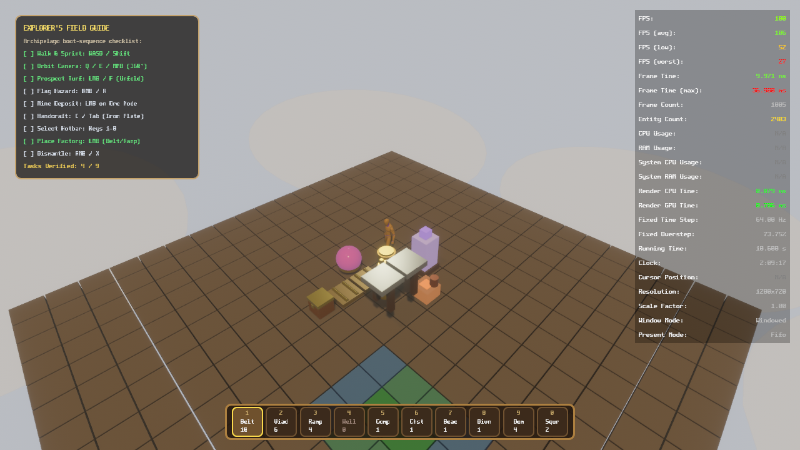
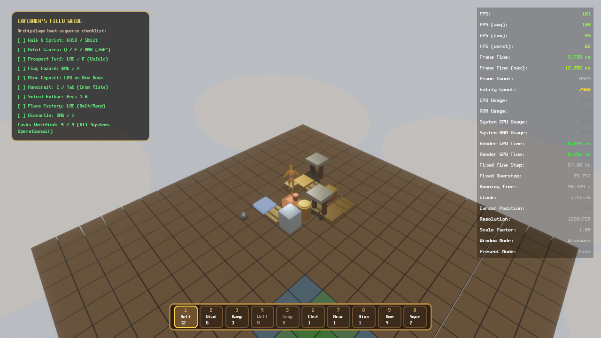
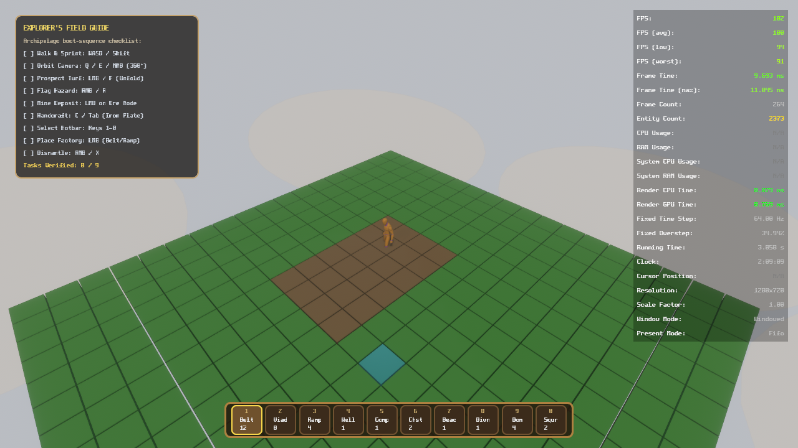
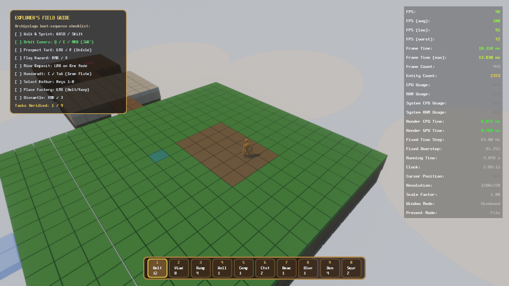
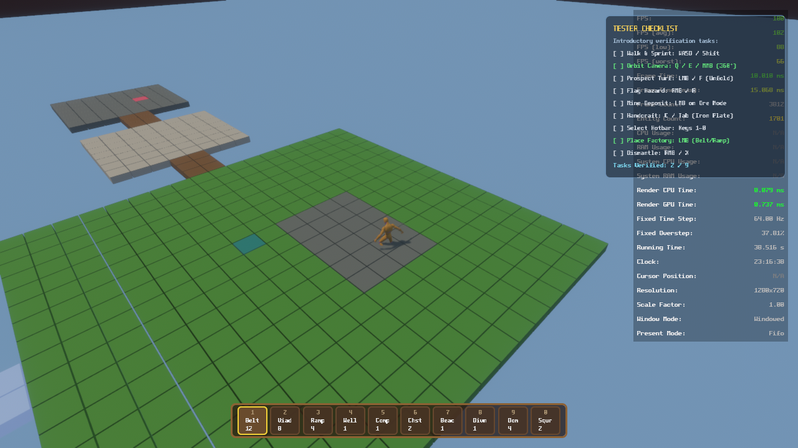
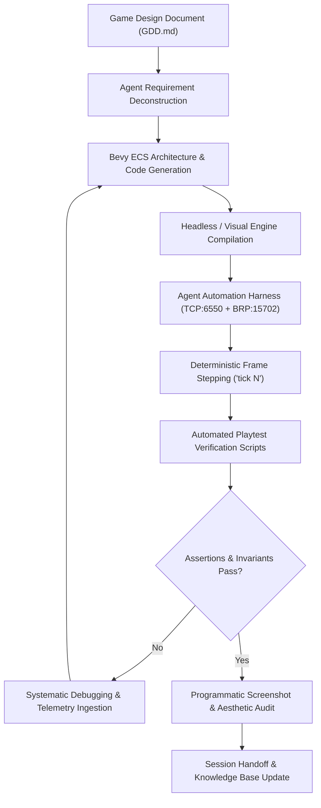

# 🏭 GRIDLOCK — 2.5D Isometric Diorama & Spatial Factory Puzzle Hybrid

> *"The machines don't just build. They play — in a miniature clockwork world of moss, brass, and pastel dreams."*

[](https://www.rust-lang.org/)
[](https://bevyengine.org/)
[](https://github.com/insufficientcharge/bevy-classic-factory-game-2)
[](https://github.com/bevyengine/bevy/tree/main/crates/bevy_remote)
[](./tests/playtest_action_combinations.ps1)

---

## 📖 Table of Contents

- [The Agentic Game Development Experiment](#-the-agentic-game-development-experiment)
- [Screenshots from Autonomous Playtesting](#-screenshots-from-autonomous-playtesting)
- [Game Vision & High Concept](#-game-vision--high-concept)
- [Technologies Used](#-technologies-used)
- [Methods Used in Agentic Development](#-methods-used-in-agentic-development)
- [Implemented Gameplay & Puzzle Mechanics](#-implemented-gameplay--puzzle-mechanics)
- [Project Structure](#-project-structure)
- [Running the Game & Agent Harness](#-running-the-game--agent-harness)
- [Autonomous Playtesting & Quality Assurance](#-autonomous-playtesting--quality-assurance)
- [Roadmap & Plans for Expansion](#-roadmap--plans-for-expansion)
- [Credits & Licensing](#-credits--licensing)

---

## 🤖 The Agentic Game Development Experiment

**GRIDLOCK** is an experimental game development project designed to answer a central question:

> **Can a rich, commercially viable 3D/2.5D game be designed, implemented, tested, and balanced entirely using autonomous AI agents?**

Working strictly from the comprehensive Game Design Document ([`GDD.md`](./GDD.md)), this repository serves as a live laboratory where AI agents (operating through tools like Google Antigravity and Claude Code) act not merely as code completion assistants, but as **primary software architects, gameplay engineers, visual designers, and autonomous playtesters**.

### How Agentic Development Operates in this Project
1. **Spec-Driven Architecture:** Agents parse high-level design specifications from [`GDD.md`](./GDD.md) and autonomously break them down into data-driven Bevy ECS architectures (Systems, Components, Resources, Events).
2. **Deep Engine Introspection:** Rather than treating the game engine as a black box, agents interact with a custom **Tri-Channel Agent Automation Harness** ([`src/agent_harness.rs`](./src/agent_harness.rs)) that exposes runtime input injection, deterministic virtual frame stepping, Bevy Remote Protocol (BRP) JSON-RPC, and telemetry streams.
3. **Closed-Loop Autonomous Verification:** Before any commit or phase sign-off, agents execute automated in-engine playtest suites ([`tests/`](./tests/)). Agents walk, mine, craft, place multi-tiered logistics, route factory belts, match chromatic gem combos, and verify invariant contracts without human manual intervention.
4. **Visual Style Auditing:** Agents trigger programmatic in-engine screenshots, rotate the axonometric diorama camera across 90° azimuth steps, and inspect rendering style, HUD alignment, and aesthetic coherence.

---

## 📸 Screenshots from Autonomous Playtesting

All screenshots below were captured programmatically by autonomous agents executing the automated playtest and visual style verification suites:

### 1. Multi-Tier Clockwork Factory in Action

*Figure 1: Automated iron ore wellhead feeding ground conveyors ($Z_0$), climbing to an elevated viaduct bridge ($Z_1$), depositing into a storage chest, alongside an active Chromatic Autoclave (Bejeweled match-3 refining), a Resonant Monolith (Sudoku harmonic frequency calibration), and real-time engine telemetry.*

### 2. Autonomous Playtest Verification (9 / 9 Tasks Passed)

*Figure 2: The Agent Automation Harness executing multi-action player combinations in frame-stepped deterministic simulation, verifying all 9 core gameplay loops (Movement, Camera Orbit, Turf Prospecting, Mine Ore, Handcrafting, Hotbar Selection, Factory Placement, Building Dismantling, and Logistics Routing).*

### 3. Diorama Archipelago & Explorer's Field Guide

*Figure 3: The Constructor automaton standing on a floating diorama islet in the cloud-sea, unfolding Minesweeper turf voxels to reveal sandstone bedrock, with the TUNIC-inspired gilded Explorer's Field Guide checklist HUD.*

### 4. 4-Way Axonometric Camera Orbit & Elevation Strata

*Figure 4: 90° orbit camera rotation demonstrating the tilt-shift axonometric perspective, beveled island cliff strata, and cloud sea depth.*

### 5. Boot Sequence & Island Generation

*Figure 5: Procedural floating archipelago diorama generation during engine boot sequence.*

---

## 🎮 Game Vision & High Concept

According to [`GDD.md`](./GDD.md), **GRIDLOCK** is a **2.5D Isometric Diorama & Spatial Factory / Puzzle Hybrid**:

- **Aesthetic Inspiration:** The lush, tactile, storybook elegance and mysterious hand-drawn manual aesthetic of **TUNIC** meets the clean, multi-layered vertical spatial automation of **Shapez 2**.
- **Setting:** **The Floating Archipelago of The Patchwork** — a miniature clockwork archipelago of sandstone cliffs, jade moss, and sparkling crystal streams floating above a dreamy cloud sea.
- **The Protagonist:** **The Constructor** (*The Gearling*) — a miniature, cloaked automaton with glowing eyes, a woolen scarf, and an oversized brass winding-key on their back.
- **The Core Hook:** Industrial processes are not governed by spreadsheets; **classic tactile mechanical puzzles are the living machines themselves**:
  - Raw ore forms **Tetris** polyominos that pack into multi-layer conveyors.
  - Refineries are brass-and-glass **Bejeweled** autoclaves performing match-3 gemstone catalysis.
  - Electrical leylines balance harmonic acoustic frequencies like **Sudoku** obelisks.
  - Terrain is surveyed by uncovering **Minesweeper** turf voxels and defusing steam vents.
  - Assembly chutes cascade marbles down **Solitaire** stepped sequences.
  - Ancient ruins open through clockwork **Wordle** tumblers and **Mahjong** stepped vault deconstruction.

---

## 🛠️ Technologies Used

### Engine & Game Foundations
- **[Rust](https://www.rust-lang.org/) (2024 Edition):** Safe, high-performance systems language enabling fast iteration with strict compiler guarantees.
- **[Bevy 0.19](https://bevyengine.org/):** Modern data-driven Entity Component System (ECS) with PBR materials, multi-threaded schedules, and modern asset pipelines.
- **[Avian3D 0.7](https://github.com/Jondolf/avian):** Fast 3D physics engine powering item colliders, ground raycasting, and obstacle detection.
- **[Bevy Ahoy 0.2](https://github.com/janhohenheim/bevy_ahoy):** Kinematic character controller handling smooth player movement, climbing, and diorama surface navigation.
- **[bevy_enhanced_input 0.26](https://github.com/projectharmonia/bevy_enhanced_input):** Declarative, contextual input mapping supporting keyboard, mouse, gamepad, and simulated agent inputs.
- **[bevy_seedling](https://github.com/CorvusPrudens/bevy_seedling), [firewheel](https://github.com/BillyDM/firewheel), & [fundsp](https://github.com/SamiPerttu/fundsp):** Spatialized procedural audio and generative toybox acoustics.
- **[bevy_asset_loader 0.27](https://github.com/NiklasEi/bevy_asset_loader) & [bevy_skein 0.6](https://bevyskein.dev):** Dynamic asset collection management, GLTF scene loading, and animation graph blending.

### The Agentic Automation & Introspection Stack
- **Tri-Channel Agent Harness ([`src/agent_harness.rs`](./src/agent_harness.rs)):**
  - **Channel 1 — Fast ASCII Control Socket (`127.0.0.1:6550`):** Low-latency line-delimited TCP socket for injecting keystrokes, camera rotation, teleportation, tile unfolding, mining, building, frame-accurate tick stepping, and screenshot capture.
  - **Channel 2 — Bevy Remote Protocol & MCP (`http://127.0.0.1:15702`):** Official Bevy BRP JSON-RPC 2.0 interface integrated with [`bevy_brp_mcp`](https://crates.io/crates/bevy_brp_mcp) for full live ECS entity queries, component reflection, and state mutation.
  - **Channel 3 — Structured Telemetry Stream (`target/agent_telemetry.jsonl`):** Non-blocking JSONL telemetry logging engine performance, FPS/frame times, subsystem lifecycle events, and panic diagnostics.
- **Agent Skill Ecosystem ([`.agents/skills/`](./.agents/skills/)):**
  - Modular skill definitions providing specialized operational protocols for agent instances:
    - [`agent-harness`](./.agents/skills/agent-harness/SKILL.md) — Socket protocol, BRP queries, and headless execution.
    - [`bevy-ecs-expert`](./.agents/skills/bevy-ecs-expert/SKILL.md) — System schedules, queries, change detection, and parallel execution.
    - [`bevy-testing`](./.agents/skills/bevy-testing/SKILL.md) — ECS unit and system integration testing patterns.
    - [`coverage-testing`](./.agents/skills/coverage-testing/SKILL.md) — LLVM source-level coverage instrumentation.
    - [`daily-work-report`](./.agents/skills/daily-work-report/SKILL.md) — Asynchronous agent session handoffs and status tracking.

---

## 🔬 Methods Used in Agentic Development



### 1. Spec-to-Playtest Closed Loop
Rather than writing code in isolation, agents implement features against specific chapters of [`GDD.md`](./GDD.md) and immediately write executable playtest harnesses. The cycle moves seamlessly from GDD rules $\rightarrow$ Bevy systems $\rightarrow$ automated test scripts $\rightarrow$ telemetry verification.

### 2. Deterministic Virtual Frame Stepping
Real-time testing in games often suffers from non-deterministic frame-rate hiccups. Through the harness command `tick pause` and `tick <N>`, agents freeze virtual simulation time and advance the engine by an exact number of frames. This allows 100% reproducible testing of conveyor item motion, physics collisions, and autoclave catalytic timers.

### 3. Headless CI & Background Daemons
Agents run the Bevy engine in background headless mode (`--agent-headless` with window visibility disabled) directly in terminal sessions. This allows full simulation execution, unit tests, and integration pipelines to run in environments without a physical display.

### 4. End-to-End Action Combination Suites
Rather than testing single isolated functions, agent test scripts simulate complex player chains:
- **Combo 1:** Prospect turf tile $\rightarrow$ Mine revealed iron deposit $\rightarrow$ Handcraft iron plates in satchel.
- **Combo 2:** Select hotbar slot $\rightarrow$ Place ground wellhead at ore node $\rightarrow$ Build directional conveyor belts $\rightarrow$ Place elevated viaduct overpass $\rightarrow$ Anchor storage chest $\rightarrow$ Verify item transport along multi-plane path.
- **Combo 3:** Deploy Chromatic Autoclave $\rightarrow$ Insert gemstone feed $\rightarrow$ Verify 3-in-a-row match detection and catalytic refined output.

### 5. Programmatic Aesthetic & Visual Auditing
Visual polish is verified through code. Agents programmatically position the diorama camera, execute 90° azimuth rotations, trigger `screenshot target/screenshots/<name>.png`, and verify terrain framing, lighting contrast, and HUD checklist layout.

---

## 🧩 Implemented Gameplay & Puzzle Mechanics

| System | Puzzle Origin | Implementation Status | Description |
|---|---|---|---|
| **Terrain Prospecting** | **Minesweeper** | ✅ Operational | Covered moss turf tiles flip to reveal sandstone bedrock; hazard detection, tile flagging (`RMB` / `R`), steam vent shockwaves. |
| **Multi-Tier Logistics** | **Shapez 2** | ✅ Operational | 3D grid snapping across Ground ($Z_0$) and Viaduct ($Z_1$) layers with transitional ramps, directional conveyors, and storage chests. |
| **Chromatic Autoclaves** | **Bejeweled** | ✅ Operational | Glass-and-brass refinery chamber performing match-3 color catalysis; resonant combo energy and refined gemstone output. |
| **Polyomino Shards** | **Tetris** | ✅ Baseline Implemented | Ore and crystalline materials structured as polyomino shards (dominoes, trominoes, tetrominoes) with bounding footprint compression. |
| **Resonant Monoliths** | **Sudoku** | ✅ Baseline Implemented | Harmonic crystal pillars emitting acoustic frequency rings (1–9) requiring non-conflicting leyline alignments across diorama quadrants. |
| **Personal Bootstrapping** | **Factorio** | ✅ Operational | The Constructor handcrafts intermediate components (Iron Plates, Winding Gears, Circuits) from raw mined ore before building machines. |
| **Diorama Camera** | **TUNIC** | ✅ Operational | Axonometric 2.5D camera with 35.264° pitch, smooth 90° Q/E orbit rotation, and tilt-shift depth framing. |
| **Explorer's Field Guide** | **TUNIC** | ✅ Operational | In-game gilded HUD checklist tracking archipelago boot-sequence tasks and real-time performance diagnostics. |

---

## 📁 Project Structure

```
bevy-classic-factory-game-2/
├── .agents/skills/               # Curated Agent Skills (harness, testing, ECS, reports)
├── assets/                       # Game models, textures, audio, shaders, and credits
│   └── credits.ron               # Asset attribution manifest
├── docs/
│   └── screenshots/              # Playtest screenshots captured by autonomous agents
├── src/
│   ├── main.rs                   # Engine entry point, plugin registration, window init
│   ├── agent_harness.rs          # Tri-channel Agent Automation Harness (TCP + BRP + Telemetry)
│   ├── asset_loading/            # Asynchronous asset loading states
│   ├── audio/                    # Seedling & Firewheel procedural toybox sound systems
│   ├── camera/                   # 2.5D Axonometric diorama camera & orbit controls
│   ├── game/                     # Core gameplay & puzzle mechanisms
│   │   ├── autoclave.rs          # Bejeweled match-3 chromatic refinery logic
│   │   ├── building.rs           # Multi-tier building placement & ghost holograms
│   │   ├── crafting.rs           # Handcrafting recipes & intermediate components
│   │   ├── diorama_world.rs      # Archipelago procedural terrain generation & cliff strata
│   │   ├── grid.rs               # 3D spatial grid (Subterranean, Ground Z0, Viaduct Z1, Skyway Z2)
│   │   ├── harmonic.rs           # Sudoku resonant monolith leylines & frequency checks
│   │   ├── hud.rs                # Explorer's Field Guide & toybox hotbar UI
│   │   ├── inventory.rs          # Satchel inventory & item stacks
│   │   ├── logistics.rs          # Multi-layer conveyor belts, viaducts, ramps & chests
│   │   ├── mining.rs             # Hand-crank drill & ore deposit extraction
│   │   ├── polyomino.rs          # Tetris 3D polyomino shard shapes & compression
│   │   ├── prospecting.rs        # Minesweeper turf unfolding & hazard flagging
│   │   └── terrain.rs            # Voxel tile components & terrain materials
│   ├── player/                   # The Constructor character controller & animation
│   ├── scene/                    # Lighting, sunbeam diurnal cycle & cloud sea
│   ├── screens/                  # Game state screens (Title, Gameplay, Loading)
│   └── ui/                       # Reusable UI widgets & color palette controls
├── tests/                        # Autonomous Playtest Scripts & Unit Test Suites
│   ├── diorama_grid_unit_tests.rs# Standalone mathematical tests for 3D grid & puzzle logic
│   ├── playtest_atomic_actions.ps1 # Atomic action validation (Move, Orbit, Mine, Craft, Build)
│   ├── playtest_action_combinations.ps1 # Multi-action player combination & chain tests
│   └── capture_style_check.ps1  # Automated screenshot capture & visual style check
├── Cargo.toml                    # Package manifest & feature flags (agent_test, native, web)
├── GDD.md                        # Master Game Design Document (1,300+ lines)
└── justfile                      # Command runner recipes for build, run, and test
```

---

## 🚀 Running the Game & Agent Harness

### Standard Visual Gameplay
```powershell
# Run native development build
cargo run

# Run with release optimizations
cargo run --release
```

### Launching with the Agent Automation Harness
The harness enables TCP port `6550` (input/stepping) and HTTP port `15702` (BRP JSON-RPC):

```powershell
# Interactive Visual Mode (window visible + harness enabled)
cargo run --features agent_test

# Headless Mode (window hidden, ideal for background automated playtests)
cargo run --features agent_test -- --agent-headless
```

---

## 🧪 Autonomous Playtesting & Quality Assurance

### 1. Running the Combination Playtest Suite
Validates 9 multi-action player gameplay chains and verifies full operational status:
```powershell
# 1. Start headless engine in background:
$job = Start-Process cargo -ArgumentList "run --features agent_test -- --agent-headless" -PassThru

# 2. Run combination playtest suite:
powershell -File tests/playtest_action_combinations.ps1

# 3. Clean up engine process:
Stop-Process -Id $job.Id -Force
```

### 2. Running Visual Style Checks
Captures high-resolution diorama and factory screenshots programmatically:
```powershell
powershell -File tests/capture_style_check.ps1
```

### 3. Running Mathematical Unit Tests
Validates 3D grid layers, coordinate height offsets, logistics routing, and match-3 autoclave combos:
```powershell
cargo test --test diorama_grid_unit_tests
```

---

## 🗺️ Roadmap & Plans for Expansion

Development continues strictly along the milestones detailed in [`GDD.md`](./GDD.md):

### Phase 1: Foundations & Architecture (✅ Complete)
- [x] 2.5D axonometric diorama camera with 4-way 90° orbit rotation (`Q` / `E`).
- [x] Procedural floating archipelago with stepped sandstone cliffs and cloud-sea.
- [x] Minesweeper turf prospecting (unfolding, flagging, hazard detection).
- [x] Multi-layer 3D logistics grid ($Z_0$ Ground, $Z_1$ Viaducts, Ramps, Storage Chests).
- [x] Bejeweled Chromatic Autoclave (match-3 color catalysis).
- [x] Tri-channel Agent Automation Harness (TCP 6550, HTTP 15702 BRP, Telemetry).
- [x] End-to-end automated playtest suites and visual style auditing.

### Phase 2: Spatial Factory & Puzzle Deepening (🔄 In Progress)
- [ ] **Tetris 3D Polyomino Shard Compression:** Full routing and bounding-box packing of multi-tile crystals across elevated viaducts and skyways.
- [ ] **Sudoku Resonant Monoliths:** Interactive 1–9 harmonic frequency balancing across quadrant leylines with visual golden resonance halos.
- [ ] **The Constructor Character Rigging:** Custom rigged cloaked automaton with bouncing woolen scarf and animated winding-key.

### Phase 3: The Full 10-Puzzle Architecture (📅 Planned)
- [ ] **Solitaire Step-Tiered Marble Cascades:** Gravity-driven stepped marble-run assembly chutes requiring descending rank and alternating polarity.
- [ ] **Mahjong Solitaire Ancient Stepped Vaults:** Excavating relic caches from multi-layer stepped stone pagodas by clearing unblocked outer tiles.
- [ ] **Connections Specimen Carousels:** Pneumatic tube sorting of mixed curiosity shipments into thematic laboratory jars.
- [ ] **Wordle Clockwork Tumbler Ciphers:** Five-ring brass dials with ancient runic glyphs unlocking sealed ruin portals.
- [ ] **Pips Sky-Barge Trade Wharves:** Dice-faceted domino crates loaded onto visiting airships according to trade manifests.
- [ ] **Crossword Synergy Grids:** Blueprint placement creating luminous keyword thread intersections where harmonic golden lilies blossom.

### Phase 4: World Traversal & Living Diorama (📅 Planned)
- [ ] **Skyway Logistics ($Z_2$ Layer):** Suspension bridges, vertical spiral lifts, and pneumatic transport canisters spanning multiple floating islands.
- [ ] **Diurnal Rhythms & Weather:** Day/night sunbeam bonuses, morning dewdrops, fireflies, and shy Ruin Sprites wandering ancient ruins.
- [ ] **Whimsical Traversal:** Pocket glider deployment, pneumatic jump pads, and aerial tramways.

### Phase 5: Autonomous Multi-Agent Game Operations (📅 Planned)
- [ ] **Continuous Autonomous Playtest Bot:** Long-running agent instances that autonomously play the game for hours, profiling economy balance, bottleneck heatmaps, and difficulty curves.
- [ ] **Automated Factory Layout Fuzzing:** Agent-driven stress testing exploring thousands of conveyor configurations to prevent deadlock and item clipping.
- [ ] **Procedural Puzzle Dungeon Generation:** Autonomous design and validation of solvable diorama puzzle islands using formal solver models.

---

## 📜 Credits & Licensing

### Credits
- The 3D models, textures, and audio assets in this project are third-party creations licensed for game development. See [`assets/credits.ron`](./assets/credits.ron) for complete author and source attributions.
- Template base derived from [Bevy New 3D RPG](https://github.com/olekspickle/bevy_new_3d_rpg).

### License
The source code and documentation in this repository are available under any of the following licenses at your option:
- [MIT License](./LICENSE-MIT)
- [Apache License, Version 2.0](./LICENSE-APACHE)
- [CC0-1.0 Universal](./LICENSE-CC0)
